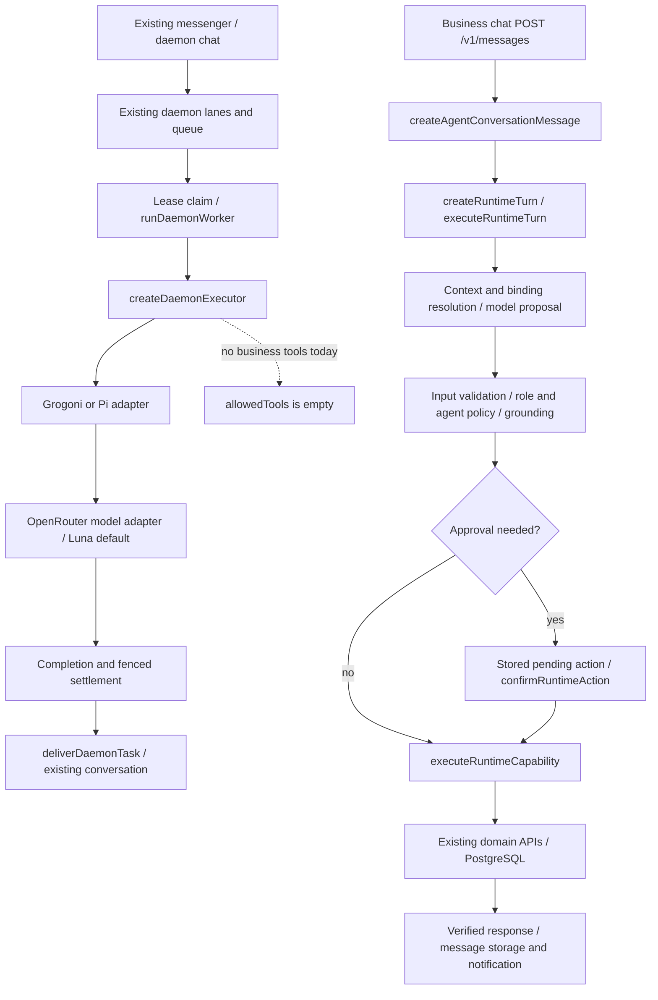

# Agent Skills architecture audit — Phase 0

Audit date: 2026-10-24. Repository: `LuckiestManAliveEver/grogoni`.
Baseline: `be9e0b30af287739ca110b2f466b56ee25793c19` (clean worktree at inspection).
Scope: source inspection, upstream specification review, and selected regression tests.
No application changes, dependency installation, database access, or migrations are part of this phase.
Source paths below are relative to the repository root; symbols identify the relevant implementation.
This is a code audit, not verification of a running deployment or its private configuration.

## Findings that determine the integration

Grogoni already owns agent orchestration, tool policy, business context, persistence, and approvals.
A small skill catalog/loader can extend those components. A new execution engine would duplicate them.

The premise that OpenCode is the backend integration is not supported by the inspected code.
Searches across API source, workspace package source, scripts, root manifest, and lockfile found no
`opencode` integration. `createDefaultAgentRuntimeAdapterRegistry()` in
`services/api/src/agent-harness/default-agent-runtime-adapters.ts` registers `grogoni` and `pi`.
The repository default is Grogoni + Luna through OpenRouter:
`packages/shared-types/src/index.ts:64` (`repositoryDefaultRuntimePolicy`),
`services/api/src/inference/openrouter-runtime.ts` (`createOpenRouterRuntime`), and
`infra/db/migrations/111_openrouter_grogoni_default.sql`. Preserve those interfaces and explicit
account/business overrides; do not introduce OpenCode merely to match the prompt's premise.
This verifies configuration identifiers, not external model availability.

There are two existing execution paths. The daemon path is deliberately chat-only; business chat
already has the authorized tool pipeline. They must not be described as one connected tool loop.
The required future daemon-to-business bridge needs a real authenticated execution context.
The synthetic `shopId: "daemon-operator"` in the daemon executor is not a tenant identity.

## Existing components and evidence

| Area                         | Existing implementation and relevant symbols                                                                                                                                                                                                                     | Implication                                                                                                                                                                                                                                       |
| ---------------------------- | ---------------------------------------------------------------------------------------------------------------------------------------------------------------------------------------------------------------------------------------------------------------- | ------------------------------------------------------------------------------------------------------------------------------------------------------------------------------------------------------------------------------------------------- |
| Agent registration/lifecycle | `services/api/src/cp2/domains/agent-runtime/routes.ts`, `registerAgentRuntimeRoutes`; `store.ts`, `AgentRuntimeDomain`, `activateAgentModel`, `registerInstalledAgentModel`; `services/api/src/cp2/domains/native-runtime/store.ts`, `NativeRuntimeBindingStore` | Catalogs, installations, active status, health checks, bindings, and runtime validation already exist.                                                                                                                                            |
| Adapter lifecycle            | `services/api/src/agent-harness/agent-runtime-adapter.ts`, `AgentRuntimeAdapterRegistry`; `grogoni-agent-runtime-adapter.ts`, `createGrogoniAgentRuntimeAdapter`                                                                                                 | Provider-independent execution boundary; prompt/output bounds, cancellation, allowed-tool intersection. Built-in adapter performs one model completion, not an autonomous tool loop.                                                              |
| Daemon                       | `services/api/src/daemon/index.ts`; `gateway.ts`, `buildDaemonGateway`; `worker.ts`, `runDaemonWorker`; `task-store.ts`, `createPostgresDaemonTaskStore`; `edge-lane.ts`, `createEdgeDaemon`                                                                     | Existing durable queue, leases/fencing, retries, deadlines, cancellation, recurring tasks, browser/server lanes, operator gateway.                                                                                                                |
| Inference                    | `services/api/src/daemon/executor.ts`, `createDaemonExecutor`, `daemonAgentPrompt`; `services/api/src/inference/openrouter-runtime.ts`; `openrouter-model-runtime.ts`, `lunaModel`; `model-runtime.ts`, `runtimeProviderFromAdapter`                             | Daemon calls existing adapters with no allowed tools. Luna remains default through OpenRouter, not OpenCode.                                                                                                                                      |
| Business model routing       | `services/api/src/cp2/domains/agent-runtime/runtime-model-routing.ts`, `createRuntimeModelRoute`; `native-runtime-routing.ts`; `native-binding-projection.ts`, `projectNativeBinding`                                                                            | Reuse model and native binding resolution; no skill-specific router.                                                                                                                                                                              |
| Current “skills”             | `packages/shared-types/src/index.ts:4667`, `AgentSkillBinding`; `services/api/src/cp2/agent-business-runtime.ts`, `defaultAgentSkillBindings`, `enforceAgentPolicy`; `services/api/src/cp2/store.ts:9712`                                                        | Existing skill IDs are typed tool names, not portable instruction-package IDs. Preserve their policy semantics.                                                                                                                                   |
| Tool discovery/contracts     | `packages/tool-core/src/registry/index.ts`, `runtimeToolRegistry`; `contracts/runtime.ts`; `validation/runtime.ts`; `capability-resolution.ts`                                                                                                                   | One canonical registry and typed validation; portable skills must reference real capabilities.                                                                                                                                                    |
| Tool dispatch                | `services/api/src/cp2/domains/agent-runtime/capabilities.ts`, `executeRuntimeCapability`; `core-read-capabilities.ts`, `executeCoreReadCapability`                                                                                                               | Existing post-policy dispatch into business APIs; `products.list` calls `queryCatalogue` or `listProducts`.                                                                                                                                       |
| Authentication/authorization | `services/api/src/cp2/store.ts:11036`, `requirePinVerifiedSession`; `:11173`, `requireAuthorizedSession`; `:11225`, `requireMembership`; `services/api/src/cp2/domains/agent-runtime/store.ts`, `executeRuntimeTurn`                                             | Business permission and membership enforced in server code; incoming natural language is not authority.                                                                                                                                           |
| Tenant/context isolation     | `runtime-context.ts`, `buildShopAgentRuntime`, `contextSourcesForRuntime`; `services/api/src/cp2/agent-business-runtime.ts`, `resolveAgentContext`, `agentAudienceForBusinessRole`; `services/api/src/cp2/edge-snapshot-scope.ts`                                | Shop/tenant identifiers and audience filters exist. Only owners receive owner context; business runtime requires membership. Loader/cache isolation still needs implementation.                                                                   |
| Messaging                    | `services/api/src/cp2/domains/messaging/routes.ts`, `registerMessagingRoutes`; `store.ts`, `createAgentConversationMessage`, `deliverDaemonTask`; `services/api/src/messaging/channel-gateway.ts`                                                                | Existing message storage, idempotency, notifications, channel adapters, and external webhooks. Encrypted human direct messages do not enter business agent processing.                                                                            |
| Business data/datasets       | `services/api/src/cp2/postgres-store.ts`, `createPostgresCp2Store`; `infra/db/schema.ts`; `services/api/src/cp2/domains/agent-runtime/business-environment-store.ts`; `packages/offline-runtime`                                                                 | Reuse PostgreSQL/Neon persistence and domain records, scoped snapshots, task environments, and offline infrastructure; no new business database.                                                                                                  |
| Approvals                    | `runtime-approval-store.ts`, `createPostgresRuntimeApprovalStore`; agent-runtime `store.ts`, `confirmRuntimeAction`; `runtime-action-policy.ts`, `runtimeActionPolicyErrors`                                                                                     | Hashed token, stored exact action, actor/business/session/conversation binding, expiry and atomic claim; confirmation revalidates current policy and input. Consuming before dispatch prevents replay but is not exactly-once external execution. |
| Sandbox                      | `services/computer-runtime/src/playwright-runtime.ts`; `network-policy.ts`, `assertNavigationAllowed`; `services/computer-runtime/Dockerfile`; `services/api/src/cp2/domains/computer-runtime`                                                                   | Isolated browser service with navigation controls is not evidence of an arbitrary skill-script sandbox. Script execution must remain unsupported initially.                                                                                       |
| Scheduling/workflows         | `services/api/src/daemon/task-store.ts`; `services/api/src/edge-job-runner.ts`; `services/api/src/cp2/domains/agent-runtime/business-task-execution.ts`, `inventory-task-controller.ts`                                                                          | Queue recurrence, maintenance jobs and inventory task coordination already exist; skill installation must not schedule work.                                                                                                                      |

### Existing portable-looking artifacts

`skills/diagnose-inference-availability/SKILL.md` has name/description frontmatter, but its body refers
to retired inference services and scripts. It is evidence of a checked-in document, not runtime discovery
or trustworthy current operational guidance. Do not auto-enable it unchanged.
`.agents/plugins/grogoni-market/skills/manage-grogoni-market/SKILL.md` is a developer-facing plugin
artifact. Neither is evidence of a tenant-aware application skill registry. No application `SKILL.md`
loader was found in the searched production source.

## Actual execution flows



Daemon entry: `apps/web/src/daemon-chat.ts` and `daemon-lane.ts` use existing daemon APIs.
`services/api/src/daemon/edge-lane.ts` declares `/v1/daemon/tasks` and claim/execute/settle routes.
`services/api/src/edge-domain-routes.ts:550` wires authenticated task ownership, conversation history,
and delivery. `daemon/conversation-history.ts`, `loadDaemonConversationHistory`, hydrates the owner's
scoped conversation; `executor.ts` passes it to the adapter. `worker.ts` settles with lease fencing.
`MessagingDomain.deliverDaemonTask` checks account/conversation ownership and uses deterministic
message identifiers. Operator tasks use the separate service-token gateway.

Business entry: `domains/messaging/routes.ts:558` parses the embedded agent request and calls
`MessagingDomain.createAgentConversationMessage` (`store.ts:3660`). It verifies PIN/session,
conversation/business scope, membership permission and absence of human direct-message recipients.
Inventory messages can be handled first by the existing inventory task controller. Other messages
call `createRuntimeTurn`; `AgentRuntimeDomain.executeRuntimeTurn` (`store.ts:2160`) authenticates,
resolves readiness, profile/binding/context, and calls `createRuntimeModelRoute`. Typed proposals then
pass registry validation, grounding, role and business policy, and approval checks before dispatch.
`confirmRuntimeAction` (`store.ts:2823`) consumes the exact stored action and rechecks authorization.
Responses return through the existing message and notification path.
The authenticated member path is not an anonymous customer inventory endpoint; Phase 3's cement
example must choose an existing appropriately restricted public surface or use a member test fixture.

## Upstream review

Reviewed the [official specification](https://agentskills.io/specification) and
[upstream repository](https://github.com/agentskills/agentskills) on the audit date. These are moving
`main`/live sources, not an immutable version pin; pin a reviewed upstream commit for Phase 1 fixtures.

The portable format requires a directory with YAML-frontmatter `SKILL.md`. Required fields:
`name` (1–64, lowercase alphanumeric/hyphen, no edge or consecutive hyphens, directory match),
`description` (1–1024). Optional: `license`, `compatibility` (1–500 when supplied), string-valued
`metadata` mapping, experimental `allowed-tools`. Optional scripts, references and assets accompany
unrestricted Markdown instructions. Disclosure progresses from metadata to activated instructions
to requested resources. Relative references start at the skill root. Under 500 lines / 5000 tokens
is guidance, not a mandatory byte ceiling. The format does not mandate a marketplace, permission
system, tenant schema, version field, scheduling engine or execution runtime. [Specification](https://agentskills.io/specification)

The [integration guide](https://agentskills.io/integrate-skills) distinguishes configurable discovery
roots from package format, recommends bounded scans and deterministic collision handling, and covers
activation/context retention. It also suggests lenient loading; that is deliberately different from
strict format validation. For Grogoni, malformed imports should receive explicit errors under the
user's strict-validation requirement. Root selection, duplicate rejection, security limits, and
permission grants are host policy, not portable format requirements.

The [reference validator](https://github.com/agentskills/agentskills/blob/main/skills-ref/src/skills_ref/validator.py)
normalizes names with NFKC and uses Unicode alphanumeric checks. The prose table's apparent ASCII
restriction and its Unicode wording require explicit Unicode fixtures rather than an assumed ASCII
regex. The validator rejects unknown top-level fields but does not fully check every optional value;
its compatibility check allows empty strings despite the prose minimum. Treat these as upstream
implementation differences. Do not infer full resource containment, sandboxing, or authorization
from a successful format validation.

The [reference CLI](https://github.com/agentskills/agentskills/blob/main/skills-ref/src/skills_ref/cli.py)
provides `validate`, `read-properties`, and `to-prompt`; validation accepts a directory or skill file
and returns success/failure exit codes. This audit read the utility source; it did not run it.

### Dependencies and licensing

[skills-ref project metadata](https://github.com/agentskills/agentskills/blob/main/skills-ref/pyproject.toml)
identifies version 0.1.0, Apache-2.0, Python >=3.11, Click >=8.0 and StrictYAML >=1.7.3.
Use it as optional development conformance tooling rather than adding a Python subprocess to the
Node API. Upstream [README licensing](https://github.com/agentskills/agentskills#license) separates
Apache-2.0 code from CC-BY-4.0 documentation. Preserve attribution/notices if copying either.
Each distributed skill needs its own license review; an optional license field is not a grant by itself.

Locally, `pnpm-lock.yaml` already contains `yaml@2.9.0`; its installed package metadata declares ISC.
It is transitive, not a declared API dependency. A later TypeScript parser should declare a direct
pinned-compatible dependency and preserve its notice. No dependency was added here. The root
`license` is PolyForm Noncommercial 1.0.0; that does not automatically license third-party skill content.
Review actual package licenses and lockfile changes before adoption; no license compatibility opinion
or approval for redistributing third-party content is implied.

## Compatibility matrix

Statuses describe current code, not planned functionality. “Implemented” does not certify all live
configurations or prove absence of vulnerabilities.

| Required capability                           | Status                | Evidence / gap                                                                                                                                    |
| --------------------------------------------- | --------------------- | ------------------------------------------------------------------------------------------------------------------------------------------------- |
| Existing daemon lifecycle and queue           | IMPLEMENTED           | `daemon/worker.ts`, `runDaemonWorker`; `task-store.ts`; `edge-lane.ts`.                                                                           |
| Existing model-independent agent interface    | IMPLEMENTED           | `agent-harness/agent-runtime-adapter.ts`; default registry registers Grogoni and Pi.                                                              |
| OpenCode backend premise                      | INCOMPATIBLE          | No integration found in searched production sources/manifests; actual adapters are Grogoni/Pi. Preserve actual code.                              |
| Luna configured primary                       | IMPLEMENTED           | `shared-types/src/index.ts:64`, OpenRouter runtime, migration 111. Live service not checked.                                                      |
| Standard skill package discovery              | MISSING               | Checked-in `SKILL.md` artifacts; no production loader found.                                                                                      |
| YAML/frontmatter and resource validation      | MISSING               | Tool input validation exists, but no skill parser/validator.                                                                                      |
| Metadata-only disclosure and activation       | MISSING               | `daemonAgentPrompt` has no skill catalog or activation mechanism.                                                                                 |
| Authorized resource reads                     | MISSING               | No skill-root resource reader / tenant-aware package cache.                                                                                       |
| Existing skill-to-agent bindings              | PARTIALLY IMPLEMENTED | `AgentSkillBinding.skillId` is `RuntimeToolName`; cannot represent portable packages without a separate binding.                                  |
| Persistent skill registry and scopes          | MISSING               | Existing model/agent catalogs and runtime profiles are not content-versioned skill records.                                                       |
| Tool registry / server dispatch               | IMPLEMENTED           | `tool-core/src/registry/index.ts`; `executeRuntimeCapability`.                                                                                    |
| Business auth and isolation foundations       | IMPLEMENTED           | `requireAuthorizedSession`, `requireMembership`, scoped snapshot/context construction.                                                            |
| Tenant isolation for skill content            | MISSING               | No skill ownership, authorization or lifecycle persistence.                                                                                       |
| Consequential-action approvals                | PARTIALLY IMPLEMENTED | Atomic stored approvals and revalidation exist; future skill revocation/version checks and complete action coverage still required.               |
| Daemon-to-business authorized skill execution | MISSING               | Daemon uses empty tools and synthetic operator shop; business runtime is a separate existing path.                                                |
| Safe treatment of untrusted context           | PARTIALLY IMPLEMENTED | `assembleAgentInferenceMessage`, `sanitizeUntrustedContext`; skill-specific trust/context fields absent. Sanitization is not a security boundary. |
| Browser sandbox                               | IMPLEMENTED           | Separate `computer-runtime` service; scoped browser/navigation capabilities.                                                                      |
| Arbitrary skill-script execution              | NOT APPLICABLE        | Initial integration is instruction-only; no verified general script sandbox.                                                                      |
| Skill activation/execution observability      | PARTIALLY IMPLEMENTED | Existing runtime/daemon telemetry; no portable skill ID/version/digest correlation.                                                               |
| Skill lifecycle/version/checksum/export       | MISSING               | No portable package lifecycle; agent/model imports are different entities.                                                                        |
| Natural-language skill creation / marketplace | MISSING               | Existing chat and runtime catalog can host later UX, but no portable skill approval/publishing workflow.                                          |
| Scheduling foundation                         | IMPLEMENTED           | Existing daemon recurrence and task environments; installing instructions is not scheduling.                                                      |

## Verification and limits

No application behavior was added. Selected existing regression results are recorded below after
execution. Tests use their existing fixtures/mocks; no live inference, Neon database, delivery provider,
Android build, browser service, or full-suite certification is claimed. Database-specific tests may
skip without their required test connection. The format reference utility was inspected, not installed.

See the [integration plan](agent-skills-integration-plan.md) for the threat model, dependency graph,
migration sequence, acceptance gates and non-goals. Stop after Phase 0 for review.

### Executed regression commands

Initial command (default workers and 5-second test timeout):

```sh
node node_modules/vitest/vitest.mjs run tests/native-daemon.test.ts tests/agent-runtime-adapter.test.ts tests/agent-business-runtime.test.ts tests/daemon-conversation-context.test.ts services/api/src/cp2/domains/agent-runtime/runtime-approval-store.test.ts services/api/src/cp2/domains/agent-runtime/runtime-approval-rejection.test.ts tests/computer-runtime-security.test.ts
```

Result: **74 passed, 3 failed, 13 skipped** across seven files. Two failures exceeded the default
5-second timeout (first native-daemon inference test and first two-shop runtime test). The daemon
history test also failed: its captured request contained the preceding test's `hello` rather than the
expected history. A timed-out test continuing after global fetch mocking changes is a plausible
explanation, not a verified product defect diagnosis. No source or test changes were made.

The four passing suites were adapter (7), daemon conversation context (1), approval rejection (6),
and computer runtime security (4). The durable approval suite skipped all 13 tests because
`CP2_POSTGRES_TEST_DATABASE_URL` was absent; database approval concurrency is source-reviewed,
not execution-verified in this audit.

Diagnostic rerun, with one worker and a larger per-test deadline:

```sh
node node_modules/vitest/vitest.mjs run tests/native-daemon.test.ts tests/agent-business-runtime.test.ts --maxWorkers=1 --minWorkers=1 --testTimeout=20000 --reporter=dot
```

Diagnostic rerun result: **59 passed, 0 failed** (daemon 42, business runtime 17), exit code 0.
Together with the four initially passing suites, all **77 non-database tests** in the selected set
passed in at least one run; **13 database tests remain skipped**. This is not a claim that the original
default-worker command passed. The rerun's clean history assertion is consistent with timeout/mock
interference in the initial run; broader timing reliability remains outside this documentation phase.

Documentation checks: Prettier on both deliverables; relative Markdown links resolved locally;
`git diff --check`; final status contains only the two new documentation files.

## Phase completion report

1. **Existing components discovered:** daemon lanes/queue, Grogoni/Pi adapters, Luna/OpenRouter,
   native bindings, tool registry/dispatcher, business context/persistence, messaging, browser service,
   task workflows, and exact-action approval storage (evidence above).
2. **Components reused:** architecture and interface boundaries reused in the proposal; existing tests
   reused for audit evidence. No application integration was implemented during Phase 0.
3. **Files created:** `docs/architecture/agent-skills-audit.md` and
   `docs/architecture/agent-skills-integration-plan.md`.
4. **Existing files modified:** none.
5. **Database migrations introduced:** none.
6. **Tests executed:** commands and results above; documentation formatting and relative links checked.
7. **Security implications:** no new executable surface or grants; plan requires scoped content access,
   untrusted instruction handling, existing server-side approval enforcement and no arbitrary scripts.
8. **Remaining gaps:** portable discovery/activation/registry, tenant-aware resources, daemon/business
   context bridge, skill-specific revocation and telemetry; live and database verification not performed.
9. **Recommended next phase:** review these deliverables, then Phase 1 only. No later phase started.
