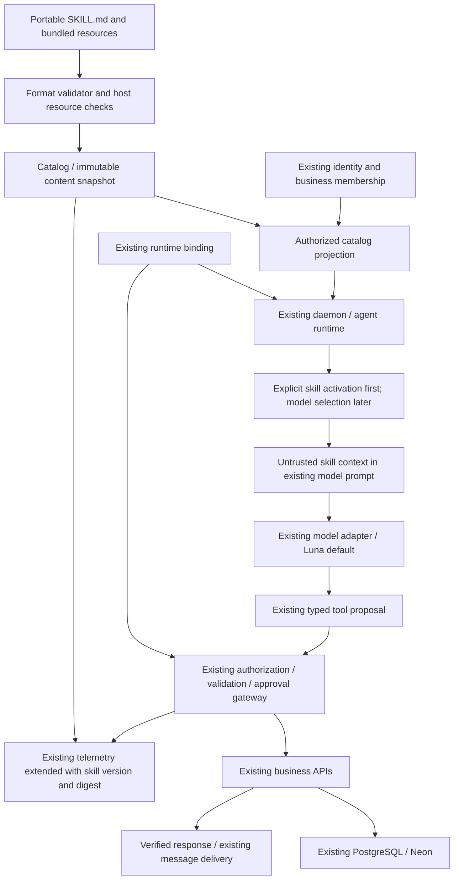

# Agent Skills minimal integration plan — Phase 0 proposal

Date: 2026-10-24. Baseline: `be9e0b30af287739ca110b2f466b56ee25793c19`.
Status: historical Phase 0 proposal; Phases 1–5 are now implemented. See [implementation](agent-skills-implementation.md). Read the [audit](agent-skills-audit.md) for evidence.
The user subsequently authorized completing all phases, superseding the original per-phase review stops.

## Integration boundary

Add a capability-management catalog and bounded content loader inside the existing API/daemon.
Use the existing agent adapters, model interfaces, tool registry, business domain APIs and approval
store. Preserve Luna/OpenRouter defaults and explicit runtime bindings. No OpenCode integration was
found; introducing one is outside this change. Skills teach procedures; tools execute operations;
existing tasks/workflows coordinate time and events.

The daemon currently cannot execute business tools. Phase 1 can validate discovery and explicit
activation on its chat-only path without granting tools. Phase 3 must bridge a verified principal
and active business into `AgentRuntimeDomain.createRuntimeTurn`, rather than dispatch tools from
`createDaemonExecutor` or adding another orchestration loop. Never turn `daemon-operator` into a
business principal. Existing business chat remains functional throughout.

## Dependency graph and proposed execution flow

Operational sequence: authenticate incoming message; resolve account/conversation and active business;
filter metadata by authority; select and activate an exact package version; add its bounded untrusted
instructions to the existing turn; obtain a typed model proposal; recheck membership, agent/tool
permissions, resource ownership and approvals; call the existing dispatcher; record actual outcome;
respond through existing messaging. Skill installation alone stops before selection and execution.

## Minimal interfaces (proposed, not existing symbols)

Implement a small module under `services/api/src/cp2/domains/agent-skills/` only after review.
Keep filesystem discovery usable by the daemon without coupling format validation to model providers.
Use existing dependency injection conventions instead of a process-global tenant catalog.

| Interface                                                | Contract and enforcement                                                                                                                                                                                                                                                                             |
| -------------------------------------------------------- | ---------------------------------------------------------------------------------------------------------------------------------------------------------------------------------------------------------------------------------------------------------------------------------------------------- |
| `discoverSkills(roots, limits)`                          | Scan only operator-configured roots; parse bounded metadata; return name, description, opaque package reference, digest and diagnostics. Do not put bodies or resources in the model catalog. Missing/malformed packages receive actionable diagnostics; no arbitrary recursive home-directory scan. |
| `validateSkill(package)`                                 | Return distinct `specification` and `grogoni-policy` diagnostics. Validate standard fields and bounded file manifests. No model call, script, network fetch or business mutation.                                                                                                                    |
| `listAvailableSkills(context)`                           | Project only enabled, authorized scopes/bindings for the authenticated actor, business and agent; do not leak hidden names or absolute storage paths.                                                                                                                                                |
| `activateSkill(context, packageId, version)`             | Reauthorize; resolve immutable digest; return bounded instructions as untrusted context and a resource manifest. Do not expand permissions or place body into trusted `agentInstructions`.                                                                                                           |
| `readSkillResource(context, activationId, relativePath)` | Reauthorize activation/version; resolve within the exact package root; enforce type, count and byte limits; read only requested resource; never run code.                                                                                                                                            |
| Registry mutations                                       | Install/enable/disable/update/uninstall through existing authenticated store/domain patterns. Publishing/generation are later phases.                                                                                                                                                                |

Phase 1 should use explicit activation syntax handled by the host and a turn-local activation record.
This avoids inventing a tool loop in the single-completion Grogoni adapter. Catalog disclosure can
support relevance selection later by extending the existing typed proposal contract with a bounded
activation operation and continuing through the existing turn pipeline. Such an extension needs tests
for call/deadline bounds; it is not permission to add a second agent runtime.

The empty-catalog/no-activation path must retain existing behavior and prompt size. Track activated
versions per authorized session to avoid duplicate instructions. Rehydrate only still-authorized
activations when history is truncated; never retain revoked content via a shared conversation cache.

## Storage and bindings

Phase 1: immutable, operator-provisioned system packages with an in-memory metadata index; no migration.
Deploy packages explicitly with the API artifact because `services/api/package.json` currently ships
`dist` only. A developer repository folder is not automatically present on an Edge deployment.
Do not enable stale checked-in operational instructions merely because they parse.

Phase 2: reuse PostgreSQL connections, migration runner, authenticated domain facade, audit records,
and scoped Edge hydration/persistence. The existing native runtime catalog, agent profiles and tool
bindings are not portable skill repositories. Add only missing entities after schema review:

| Proposed entity   | Required data / constraint                                                                                                                                                                                                                                        |
| ----------------- | ----------------------------------------------------------------------------------------------------------------------------------------------------------------------------------------------------------------------------------------------------------------- |
| Skill identity    | Opaque ID; display metadata; scope `SYSTEM`, `TENANT`, or `USER`; business/account owner; publisher/source. Scope/owner shape constrained in database. Scope is not inferred from a directory name.                                                               |
| Immutable version | Skill ID; internal content version; source revision; SHA-256 manifest digest; package manifest and bounded content; validation result; optional upstream spec reference; timestamps and license evidence. Do not invent a mandatory portable `specVersion` field. |
| Installation      | Skill/version ID; authorized business/user target; lifecycle/status; enabled flag; granted capability references; installing actor; timestamps. Unique target/package binding; update pointer atomically.                                                         |
| Agent binding     | Installation/version to existing agent identity; allowed capability subset and optional intent restrictions. Preserve existing `AgentSkillBinding` tool policy; use a separate portable package binding.                                                          |
| History           | Immutable version records plus existing audit events for installation, enabling, updates, revocation, disable and uninstall.                                                                                                                                      |

Exact table names and migration numbers are intentionally deferred until Phase 2 checks the then-current
schema. Existing migrations already reach 124; do not reserve a stale numeric slot. Prefer bounded
content in existing PostgreSQL persistence initially; no new storage service is required. Large binary
assets remain unsupported until an existing blob interface has tenant-aware retention and limits.

Lifecycle: `DISCOVERED → VALIDATED → INSTALLED → ENABLED`; disabling returns to installed/inactive.
Validation/installation failure cannot publish an enabled pointer. Build and validate a complete version,
commit content and installation atomically, then enable. Updates create a new immutable version;
existing approved operations remain bound to their original snapshot and are denied if revoked or
no longer authorized. Uninstall prevents new activation, invalidates sessions, and retains only required
history under existing deletion/retention rules. Disable/revoke takes effect on the next resource read
and before every tool execution. Cache keys include owner scope, package ID, digest and grant revision;
metadata caching never substitutes for authorization.

## Tool authorization and approval

Effective tools are the intersection of existing actor permissions, active business ownership, agent
policy, registry definitions, installation grants, any declared skill restrictions, and current runtime
binding. `allowed-tools` is experimental package metadata; it cannot grant authority in Grogoni.
Unknown capability references produce errors, not executable code.

Use `runtimeToolRegistry`, `validateRuntimeToolInput`, `runtimeActionPolicyErrors` and
`executeRuntimeCapability` in the existing `AgentRuntimeDomain` flow. Domain APIs continue checking
resource ownership. Discovery permission does not imply tool permission. A skill with no authorized
operation can still supply instructions, but cannot claim a successful mutation.

Reuse `RuntimeApprovalStore` and `confirmRuntimeAction`: exact parameters, actor, tenant, runtime
session, conversation, expiry and atomic claim already exist. Extend associated server-side execution
metadata with skill ID/version/digest and grant revision; revalidate revocation before dispatch.
Require explicit approval for external sending, order submission, transfers, deletion, publication,
and sensitive setting changes. Audit each actual tool definition/handler before marking Phase 3
complete; existing support is not proof every future operation is gated. Unknown outcomes after an
external timeout require reconciliation/idempotency, not replaying consumed approval tokens.

## Security threat model

Assets: business/customer records, credentials, private skill instructions, approval authority,
message integrity, model budget and service availability. Adversaries include malicious package
publishers, compromised sources, authenticated cross-tenant users, and prompt-injected model output.
Trust boundaries are package ingestion, filesystem/content reads, model context, authenticated store
calls, external providers, and persistence/cache hydration.

| Threat                                                         | Required control                                                                                                                                                                           | Verification gate                                                                             |
| -------------------------------------------------------------- | ------------------------------------------------------------------------------------------------------------------------------------------------------------------------------------------ | --------------------------------------------------------------------------------------------- |
| Skill says to bypass policy or reveal data                     | Treat body, description and resources as untrusted; escape catalog serialization; keep trusted policy separate; authorization outside the model                                            | Injection fixture cannot widen tool list or expose owner-only context.                        |
| Cross-tenant discovery/read/cache reuse                        | Scope every lookup and activation; authorize before returning metadata; partition caches; deny mismatched agent/conversation                                                               | Two businesses with equal skill names cannot see each other's metadata or files.              |
| Traversal, absolute paths, symlink/hardlink escape, read races | Resolve against approved immutable package snapshot; reject escapes and unsafe file types; copy/validate regular files into controlled storage; do not follow attacker-modifiable symlinks | Traversal, encoded path, symlink and changed-file fixtures fail closed.                       |
| YAML/resource exhaustion                                       | Safe parser without executable tags; duplicate-key/type checks; bound aliases, scan depth, files, bytes, output and aggregate model context                                                | Oversized/recursive/alias-heavy fixtures rejected with host-policy diagnostic.                |
| Malicious scripts or install hooks                             | Instruction-only support; no subprocess, install hook or evaluator; read scripts as inert content only if policy allows                                                                    | Import/activation performs no child-process execution.                                        |
| Supply-chain replacement / stale activation                    | Immutable versions and digests; verified ingestion; atomic pointers; invalidate on revoke                                                                                                  | Changed source cannot silently alter activated instructions or approved action.               |
| Permission escalation / revocation race                        | Recheck principal, membership, tool policy, grants and package status before dispatch and resource reads                                                                                   | Revoke after activation or approval blocks execution.                                         |
| Approval replay or parameter swap                              | Existing stored action and atomic one-time claim; bind skill version/digest; current policy recheck                                                                                        | Altered parameters and second claim denied; external uncertain outcomes reconciled.           |
| Exfiltration through messages/network                          | Existing approved tool gateway; no package-controlled fetch; existing external messaging and browser network policies                                                                      | External effects cannot occur through activation alone.                                       |
| Sensitive logs / publication                                   | IDs, digest, capability, decision, outcome and failure category only; existing retention/deletion; separate publication review                                                             | No instructions, tokens, customer records or private source paths in telemetry/public export. |

Proposed initial host limits: 128 KiB per `SKILL.md`, 256 KiB per text resource, 2 MiB total package,
100 regular files, depth 4, at most 100 disclosed skills, and a bounded aggregate activation budget
within the adapter's existing 131072-byte prompt limit. These are proposed Grogoni restrictions,
not official specification limits; tune and document them before Phase 1 acceptance. Reject duplicate
names within a discovery scope with diagnostics; resolve explicit IDs across authorized scopes to
avoid silent cross-tenant shadowing. Do not silently truncate instructions into a misleading procedure.

The browser runtime is not an approved arbitrary-code sandbox. Keep scripts unsupported through
these phases unless a separately reviewed execution environment and business authorization contract
are approved. Reusing browser navigation is limited to existing typed browser capabilities.

## Standard versus Grogoni extensions

Portable content follows the linked format specification; Grogoni adds scopes/owners, internal IDs,
checksums, lifecycle, grants, approvals, tenant-aware caches, quotas and audit records. Store these
extensions outside `SKILL.md` (database records or separate export sidecar). Do not put runtime
credentials, customer data or permissions into portable instructions. Standard package metadata
may describe dependencies; it does not install them or authorize their use.

## Proposed migration sequence and acceptance gates

1. **Phase 1: format and instruction-only activation.** Add bounded parser/discovery/reader and explicit
   activation in the current daemon. Use existing adapter/model interfaces and return untrusted
   context. Package deployable system skills explicitly. No schema change. Tests: valid and invalid
   frontmatter, field types/Unicode, missing file, duplicates, containment, resource limits, metadata-only
   discovery, activation, zero-skill compatibility and no scripts. Acceptance requires actual daemon
   activation tests, not merely parser tests. Stop for review.
2. **Phase 2: persistent ownership and lifecycle.** Inspect current schema again; add only identity,
   immutable content/version, installation and binding data that has no equivalent. Wire scoped Edge
   reads/writes, deletion and audit retention. Backfill no private grants automatically. Test atomic
   installation failure, two-tenant isolation, user/system ownership, unauthorized mutations, updates,
   revocation and cache invalidation. Migration/rollback run against an isolated PostgreSQL fixture.
   Stop for review.
3. **Phase 3: operational integration.** Add the narrow daemon-to-business context bridge, reusing
   `createRuntimeTurn` and current dispatcher. Keep operator chat tool-free. Test available/unavailable
   cement stock, unauthorized access, tool failure and model failure; assert real fixture inventory
   reads and response delivery. Include approval/replay, resource ownership and revoked grants.
   Anonymous customer behavior needs a restricted existing public path, not member impersonation.
   Extend telemetry with skill/version/digest and authorization outcomes. Stop for review.
4. **Phase 4: conversational drafting.** Existing chat/model proposes portable content; validate and
   preview behavior plus capabilities; store draft separately; explicit owner approval installs it.
   Edit/disable/uninstall through existing surfaces. Scheduling is a distinct existing daemon/task
   operation needing its own authority; unsupported triggers must be reported. Stop for review.
5. **Phase 5: distribution.** Extend existing runtime-registry search/import and app surfaces only
   where their interfaces fit; do not treat their current model/agent imports as skill support.
   Add publisher attribution, visibility, validation, version pinning, revocation and portable export.
   Publishing and capability grants require explicit approval; private tenant records are excluded.
   Test publisher/installing-business isolation. Stop for review.

Every phase retains the no-skills path and records executed tests and limitations. No live production
migration, publish, external message, deployment or permission grant is authorized by this proposal.

## Explicit non-goals

- Replacing daemon lanes, runtime adapters, model selection, messaging, contacts, authentication or mobile execution.
- Adding OpenCode, another agent orchestrator, a generic script engine, a new model router or database service.
- Reinterpreting existing tool permission bindings as portable skill packages.
- Treating natural-language instructions, publisher verification or `allowed-tools` as permission grants.
- Automatic scheduling, external actions, package dependency installation or script execution on activation.
- Building a separate marketplace/admin application or claiming current customer workflows are member-authorized.

## Phase 0 review decisions

Confirm the source-backed Grogoni/Pi + OpenRouter baseline, instruction-only first release, explicit
activation first, separate package versus tool bindings, and proposed host limits. These are concrete
implementation choices for review, not changes made in this phase. Recommended next phase: Phase 1
only after review of both documents and the actual regression results in the audit.
